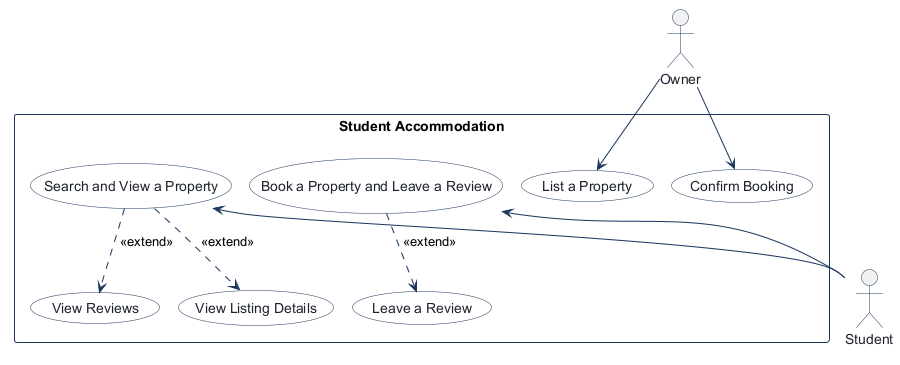
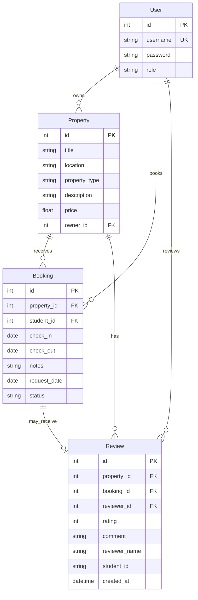
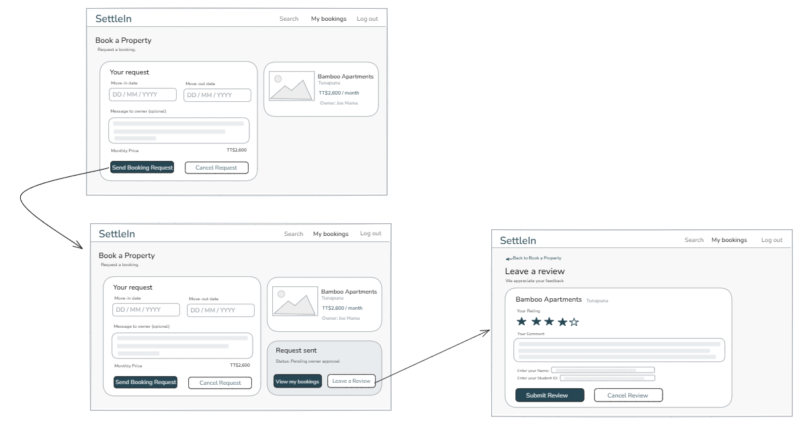
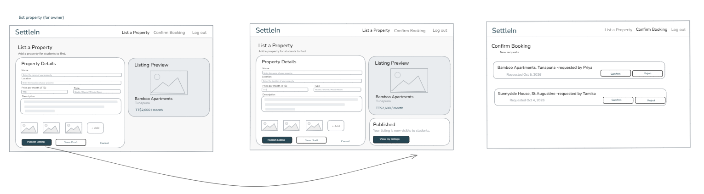
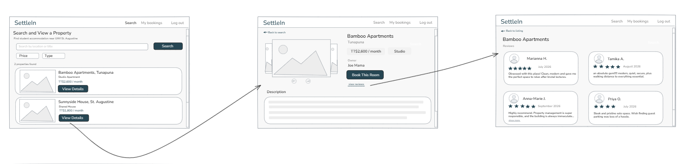

<!-- student-build:skill-integrity
status: pass
root: e84cd692d0b85eefe546385661958c27d07e8be6c5176a82012f68ccff5c8beb
expected_root: e84cd692d0b85eefe546385661958c27d07e8be6c5176a82012f68ccff5c8beb
mismatches: none
-->

# COMP 3613 Assignment 1

YouTube: https://youtu.be/pW2NlXFtrAo

GitHub: https://github.com/priya-oudai/comp3613a1

Agent: GitHub Copilot (Agent mode)

## Assigned project

Student Accommodation

## Three workflows

### 1. 

List a Property (Owner)

The owner acts.

Steps: When an owner logs in for the first time, they see a "List a Property" button and a message saying they have no listings yet. An owner who has already published properties sees the same button, with their existing listings underneath. The owner clicks "List a Property" and fills in the property details form. From there they can Cancel, Save Draft, or Publish Listing.

Done: The owner publishes the listing and the new property appears in their list of listings, visible to students.

### 2.

Search and View a Property (Student)

Student acts.

Steps: When a student logs in, they see a page listing the available properties, along with a count of how many were found. A search bar lets them search by title or location, and the Price and Type filters help them narrow the list to find a place that suits them. Each property has a View Details button, which opens a page with more information about it. From there the student can click "view reviews" to read the reviews other students have posted for that property, or click "Book This Room" to go to the booking page.

Done: The student has found a property and viewed its details and reviews.

### 3.

Book a Property and Leave a Review (Student)

The student acts. The owner then confirms or rejects the request.

Steps: From a property's details page, the student clicks "Book This Room", which opens the booking request page. There they enter their move-in and move-out dates and can add an optional message to the owner, then click "Send Booking Request" or "Cancel". After sending, the student can open "My bookings" in the top navigation bar to see every booking they have made, each with its status: pending, confirmed or rejected. A student can leave one review for a property they have booked, as long as the booking status is pending or confirmed. After submitting a review, they cannot submit another for that booking unless they make a new booking. The owner decides each request on the Confirm Booking page by clicking Confirm or Reject.

Done: The booking request is sent and appears in My bookings with its status, the student's review is saved, and the owner has confirmed or rejected the request.

## Use case diagram

Assumption: Search and View a Property extends View Listing Details and View Reviews; Leave a Review is offered immediately after a student sends a booking request; Confirm Booking is a separate Owner workflow and is not tied to List a Property.

## Model diagram

Updated to match the SQLModel entities, field constraints, defaults, and relationships in `app/models/`.

Model revision: this update aligns the ERD with the implemented SQLModel names and constraints. It now marks `User.username` as unique; documents required, indexed foreign keys from Property, Booking, and Review to their owning User, Property, Booking, or reviewer; and makes clear that a Booking can have at most one Review because `Review.booking_id` is unique. The diagram now includes the implemented `Booking` check-in/check-out dates and the separate Review `reviewer_name`, `student_id`, and automatically generated `created_at` fields. In the code, Property price is nonnegative and defaults to 0, property type defaults to `studio`, description and booking notes default to empty strings, Booking request date defaults to today, and its status defaults to `pending` and is restricted to `pending`, `confirmed`, or `rejected`. Review rating defaults to 5 and is restricted to 1–5; its comment defaults to empty text. A review timestamp is generated automatically. There is no confirmation-date field. Students may review pending or confirmed bookings; rejected bookings cannot be reviewed. Review cancellation is navigation only and adds no persisted field.

## Wireframes

### List a Property and Confirm Booking

<!-- student-build:wireframe-coverage
use_case: List a Property (Owner)
image: docs/wireframes/List a Property and Confirm Booking.png
covered: yes
-->

### Search and View a Property

<!-- student-build:wireframe-coverage
use_case: Search and View a Property (Student)
image: docs/wireframes/Search and View a Property.png
covered: yes
-->

### Book a Property and Leave a Review

<!-- student-build:wireframe-coverage
use_case: Book a Property and Leave a Review (Student)
image: docs/wireframes/Book a Property and Leave a Review.png
covered: yes
-->

Accepted model revisions: `Booking.status` distinguishes pending/confirmed/rejected, with no completion step; `Review` now stores reviewer name and Student ID from the wireframe. The booking flow immediately presents “View my bookings” and “Leave a Review” after request submission.

### Book a Property and Leave a Review

### List a Property and Confirm Booking

### Search and View a Property

## Theming

Branding preference: SettleIn as the product wordmark, with a warm, modern student-living aesthetic. Applied across the landing page, sign-in, register page, and authenticated app shell via the centralized CSS brand tokens and shared wordmark markup. Latest appearance polish: ivory page background, light-brown top navigation, rose-gold property cards, and warm beige-gold buttons. The Search and View hero uses the student-provided living-room image as a full-width background, with a translucent ivory overlay to keep the heading, subtitle, search field, and filters readable. Student confirmed the search hero writing and controls remain clearly readable.

## Implementation notes

One named workflow at a time. Include verify notes and polish / model revisions (Phase 5). Do not treat the first build as final.

Phase 5 polish: registration now collects username, password, and a Student/Owner role; email was removed to match the Phase 3 User entity. The seeded `bob` account is an owner. Owner accounts see listing management and the “List a property” action, while student search and booking widgets remain student-only. Listing routes and the service reject non-owners.

The listing form retains only the Phase 3 Property fields: title, location, monthly price, type, and description. Photo uploads were skipped; the form, listing cards, and detail page use a shared SettleIn placeholder image instead. Student verification confirmed Bob no longer sees student search/bookings and sees the owner “List a property” action with the expected form fields and placeholder.

Polish from that verification: the form now includes Cancel and Save Draft. Cancel clears any temporary draft and returns to the owner dashboard; Save Draft stores the five form values in this browser tab’s session storage only. Student verification confirmed the values restore after leaving and reopening the form, and Cancel clears them.

Student-registration check exposed another role mismatch: the student dashboard still showed “My listings.” That panel and its owner-list query were removed from the student view. The student rechecked and confirmed the owner-only message is gone and only “My bookings” remains in the dashboard sidebar; the student search area is retained.

Owner listing-flow polish: the owner landing dashboard now uses the wireframe heading “List a Property” and subtitle “Add a property for students to find.” After a successful publish, a one-time “Published / Your listing is now visible to students” panel appears on that dashboard, with “View my listings” linking to the owner’s listing cards. Student browser verification confirmed the heading, subtitle, and jump link.

Owner navigation now matches the wireframe’s top bar (SettleIn, List a Property, Confirm Booking, Log out), with the active page bold. Confirm Booking is a dedicated owner-only view of pending requests with Confirm and Reject actions. Student review submission is available immediately after booking request; the request confirmation provides View my bookings and Leave a Review actions. The Review form captures the required reviewer name and Student ID. Startup adds missing Review identity columns and Booking request date without dropping existing booking or listing data. Student verification confirmed the owner navigation/highlight, both booking decisions, pending-list removal, student booking confirmation actions, and review submission.

Booking lifecycle alignment: the only supported states are pending, confirmed, and rejected. Owners can confirm or reject pending requests; the prior completion action was removed. A student with a pending or confirmed request may submit one review; rejected requests cannot be reviewed.

Authentication note: the app stores the JWT in one `access_token` cookie per site origin. Logging in as another user in the same browser profile replaces that cookie, so all tabs then authenticate as the latest account. To test owner and student at the same time on the live site, markers should use two browsers or an incognito window.

Earlier Phase 5 verification: student confirmed that the owner and student workflows, including role-specific navigation, property listing, booking confirmation/rejection, booking-request actions, and review submission, work as expected.

Search and View polish: the student completed Property model, repository, service, and thin-route snippets. Search now has the requested title/subtitle, price bands (under TT$1,500; TT$1,500–2,500; over TT$2,500), type filter, result count, and horizontal result cards. Price-band comparisons keep the boundary values in the middle band only. Student navigation is a top bar with Search, My bookings, and Log out; My bookings opens its own page. Property details place the placeholder photo beside the title, location, owner, booking action, and reviews link, with the description below. Book This Room opens the booking request form; View Reviews opens the separate property review list. Student verification confirmed the filters, count, cards, details, booking action, and My bookings. The student reported the Leave a Review form needed a Cancel Review action returning to property details; after it was added, the student confirmed it returns to the same property's details without submitting the review.

Further review/listing polish from the wireframe: property reviews show a profile icon beside the reviewer name and the automatically saved month/year. The existing Leave a Review form remains on the property details page, with the “Back to Book a Property” link, requested heading and feedback line, and property title/location. Owner listing details now have a “Property Details” subheading and title, location, and price placeholders; the existing Type choices are unchanged. Student verification confirmed the Search page’s View Details button opens the property details page again after the route fix; the Leave a Review link and owner listing placeholders match the wireframe; and the Reviews page profile icon and month/year match the wireframe.

Skips: 1/3 used
- Photo uploads — assumed: display a shared placeholder image rather than collect or store image files.

<!-- student-build:code-check
workflow: List a Property (Owner)
form: snippet
layer: model
architecture_ok: yes
implement_confidence: 0.40
passed: yes
note: User entity role is required so registration must supply the selected student/owner role; email removed per Phase 3.
-->

<!-- student-build:code-check
workflow: List a Property (Owner)
form: snippet
layer: router
architecture_ok: yes
implement_confidence: 0.50
passed: yes
note: Student added owner-only guards to both listing-form GET and create POST handlers without persistence logic.
-->

<!-- student-build:code-check
workflow: List a Property (Owner)
form: snippet
layer: service
architecture_ok: yes
implement_confidence: 0.55
passed: yes
note: Student added the owner-role check in PropertyService before creating a listing.
-->

<!-- student-build:code-check
workflow: List a Property (Owner)
form: mcq
layer: router
architecture_ok: yes
implement_confidence: 0.35
passed: no
note: Initially selected Service for role-specific dashboard display; the router selects view context and the service enforces listing rules.
-->

<!-- student-build:code-check
workflow: List a Property (Owner)
form: choice
layer: other
architecture_ok: yes
implement_confidence: 0.60
passed: yes
note: Student chose browser-session storage instead of a database record for Save Draft.
-->

<!-- student-build:code-check
workflow: List a Property (Owner)
form: open
layer: other
architecture_ok: yes
implement_confidence: 0.65
passed: yes
note: Student verified Save Draft restores form values after navigation and Cancel clears the saved values.
-->

<!-- student-build:code-check
workflow: Search and View a Property (Student)
form: open
layer: router
architecture_ok: yes
implement_confidence: 0.65
passed: partial
note: Student spotted owner-only “My listings” content on a Student dashboard; the panel and unnecessary query were removed.
-->

<!-- student-build:code-check
workflow: Search and View a Property (Student)
form: open
layer: router
architecture_ok: yes
implement_confidence: 0.70
passed: yes
note: Student rechecked the Student dashboard; owner-only listing content is gone and My bookings remains.
-->

<!-- student-build:code-check
workflow: Confirm Booking (Owner)
form: choice
layer: other
architecture_ok: yes
implement_confidence: 0.50
passed: yes
note: Student selected a dedicated Confirm Booking page with Confirm and Reject actions, as shown in the wireframe.
-->

<!-- student-build:code-check
workflow: Confirm Booking (Owner)
form: mcq
layer: service
architecture_ok: yes
implement_confidence: 0.55
passed: yes
note: Student identified Service as the layer that coordinates pending-to-rejected decisions.
-->

<!-- student-build:code-check
workflow: Confirm Booking (Owner)
form: snippet
layer: model
architecture_ok: yes
implement_confidence: 0.60
passed: yes
note: Student constrained Booking.status to pending, confirmed, and rejected, excluding a completion state.
-->

<!-- student-build:code-check
workflow: Confirm Booking (Owner)
form: snippet
layer: repository
architecture_ok: yes
implement_confidence: 0.65
passed: yes
note: Student implemented the owner-scoped pending booking query in the repository.
-->

<!-- student-build:code-check
workflow: Confirm Booking (Owner)
form: snippet
layer: service
architecture_ok: yes
implement_confidence: 0.70
passed: yes
note: Student implemented pending request retrieval and owner/pending checks before rejection.
-->

<!-- student-build:code-check
workflow: Confirm Booking (Owner)
form: snippet
layer: router
architecture_ok: yes
implement_confidence: 0.75
passed: yes
note: Student completed the owner-only request page and thin confirm/reject action routes through BookingService.
-->

<!-- student-build:code-check
workflow: Book a Property and Leave a Review (Student)
form: choice
layer: model
architecture_ok: yes
implement_confidence: 0.70
passed: yes
note: Student chose to include reviewer name and Student ID on Review to match the wireframe.
-->

<!-- student-build:code-check
workflow: Book a Property and Leave a Review (Student)
form: snippet
layer: model
architecture_ok: yes
implement_confidence: 0.75
passed: yes
note: Student added required reviewer_name and student_id fields to ReviewBase.
-->

<!-- student-build:code-check
workflow: Book a Property and Leave a Review (Student)
form: snippet
layer: service
architecture_ok: yes
implement_confidence: 0.80
passed: yes
note: Student trims and validates name and Student ID in ReviewService and maps them to ReviewBase.
-->

<!-- student-build:code-check
workflow: Book a Property and Leave a Review (Student)
form: snippet
layer: router
architecture_ok: yes
implement_confidence: 0.80
passed: yes
note: Student binds reviewer name and Student ID in the thin review action and passes them to the service.
-->

<!-- student-build:code-check
workflow: Search and View a Property (Student)
form: snippet
layer: model
architecture_ok: yes
implement_confidence: 0.60
passed: yes
note: Student added indexes to Property.price and Property.property_type for the agreed filters.
-->

<!-- student-build:code-check
workflow: Search and View a Property (Student)
form: snippet
layer: repository
architecture_ok: yes
implement_confidence: 0.65
passed: yes
note: Student preserved text search and added optional price and type predicates; Guide added exclusive-bound flags to avoid overlapping price bands.
-->

<!-- student-build:code-check
workflow: Search and View a Property (Student)
form: snippet
layer: service
architecture_ok: yes
implement_confidence: 0.70
passed: partial
note: Student mapped the selected bands and delegated to the repository; boundary exclusivity was tightened during integration.
-->

<!-- student-build:code-check
workflow: Search and View a Property (Student)
form: snippet
layer: router
architecture_ok: yes
implement_confidence: 0.75
passed: yes
note: Student's route passes query, price band, and type to PropertyService and derives the result count without persistence logic.
-->

<!-- student-build:code-check
workflow: Search and View a Property (Student)
form: choice
layer: other
architecture_ok: yes
implement_confidence: 0.75
passed: yes
note: Student chose a separate My bookings page because the search wireframe did not show its destination.
-->

## Deployed app

Phase 6. Public Render URL (not localhost). Markers open this to mark the three workflows.

https://faststarter-db0v.onrender.com

Health check: https://faststarter-db0v.onrender.com/health responds successfully.

GitHub: https://github.com/priya-oudai/comp3613a1

Agent: GitHub Copilot (Agent mode)

## Logins

Every account a marker needs, including extra users you added. Starter accounts:

- bob / bobpass — owner
- admin / adminpass — admin
- student1 / studentpass — student

## YouTube URL

[https://youtu.be/pW2NlXFtrAo](https://youtu.be/pW2NlXFtrAo)

## Session transcripts

Filled when the Guide builds the report: the agent writes chat markdown into `docs/transcripts/`; `python manage.py report` packages them.

Guide packaged **8** chat(s) in `docs/transcripts/` (and `docs/transcripts.zip`).

Index: [docs/transcripts/INDEX.md](transcripts/INDEX.md)

- [`phase-1-project-and-workflows`](transcripts/phase-1-project-and-workflows.md)
- [`phase-2-use-cases`](transcripts/phase-2-use-cases.md)
- [`phase-3-model`](transcripts/phase-3-model.md)
- [`phase-4-wireframe-coverage`](transcripts/phase-4-wireframe-coverage.md)
- [`phase-4-wireframes-pending`](transcripts/phase-4-wireframes-pending.md)
- [`phase-5-theme-build-polish`](transcripts/phase-5-theme-build-polish.md)
- [`phase-5-wireframe-polish`](transcripts/phase-5-wireframe-polish.md)
- [`phase-6-deployment-and-report-updates`](transcripts/phase-6-deployment-and-report-updates.md)

## Competency (student-judge)

Filled by Guide from the student-judge run when this report was built.

**Judged at:** 2026-10-11T16:32:12-04:00  
**Student / session:** Student Accommodation project; Copilot Agent Guide chats  
**Artifact:** All eight accessible Guide chats saved under `docs/transcripts/`, plus the current report, model sources, diagrams, and wireframes  
**Phases in evidence:** 1–6 (COMP 3613; Phase 5 polish, Phase 6 deploy; never generic 0–5)  
**Evidence pass:** re-read native chats and current project artefacts; no prior scorecard used

### Totals

| | Count / value |
|--|--|
| Metrics on rubric | 12 (M1–M12) |
| N/A (excluded) | 0 |
| Metrics scored | 12 |
| Scoreable max | 12 × 4 |
| Awarded total | 44 / 48 |
| **Overall (avg of scored)** | **3.7 / 4** |
| Impression mark | 18 / 20 |

## Scorecard

| ID | Metric | Score / 4 | In avg | Evidence |
|----|--------|----------:|:------:|----------|
| M1 | Phase discipline | 3 | yes | The student worked through the design phases, completed local polish before deployment, and supplied the live URL. |
| M2 | Problem framing | 4 | yes | “For search and view a property have an extend use case to view listing details … and book a property should have an extend to leave a review.” |
| M3 | Decision ownership | 4 | yes | The student named the workflows and model fields, specified `Confirm Booking` as “separate and independant,” and chose the later review path. |
| M4 | Artefact-before-code | 3 | yes | The report contains the student-named entity model and all three wireframes before the Phase 5 implementation and refinement. |
| M5 | Verification habit | 4 | yes | “yes everything works”; later the student reported concrete role, booking, route, review, and appearance checks and requested further refinements. |
| M6 | Assignment fit | 3 | yes | Implementation notes and code-check evidence show ERD/wireframe-led work, role-aware features, and service/repository use; persistence calls were not found in routers during this evidence pass. |
| M7 | Slice explanation | 4 | yes | The report records model, repository, service, and thin-route snippets; e.g. the student's route “passes query, price band, and type to PropertyService … without persistence logic.” |
| M8 | Prompt quality | 3 | yes | The student used phase-tagged prompts and gave specific mismatch and polish requests, including Search page controls, Cancel Review, review display date, and navigation behavior. |
| M9 | Response to pushback | 4 | yes | The student continued after verification with “there are a couple of things that needs changing” and later confirmed the repaired View Details path worked. |
| M10 | Integrity | 4 | yes | No external-assist/paste-back flags, sincerity spiral, or skill-edit evidence appeared in the accessible chats or current artefacts. |
| M11 | Provenance continuity | 4 | yes | The project, named accommodation workflows, ERD, wireframes, implementation, and later refinements remain consistent across the saved phase chats. |
| M12 | Sincerity trajectory | 4 | yes | No suspicion was raised; therefore no suspicion round was abandoned or left unresolved. |

## Strengths

- Student chose the project and named three user/workflow pairs.
- Student made explicit include/extend and independent-use-case decisions.
- Student named entities and properties, then engaged in relationship and workflow clarification.
- Student supplied wireframes and used them to guide extensive Phase 5 verification and polish.
- Student completed layered code checks; recorded route snippets call services rather than executing persistence logic in routers.
- Student provided a working public Render URL and marker account credentials.

## Gaps (priority order)

None identified from the available evidence.

## Phase gate status

| Phase | Status | Note |
|-------|--------|------|
| 1 | met | Student Accommodation and three named workflows are recorded. |
| 2 | met | Use-case relationships and independent Confirm Booking case are recorded in the UML artefact. |
| 3 | met | Student-named entities/properties and model relationships are present. |
| 4 | met | Three wireframes are embedded with coverage notes; booking/review path was clarified. |
| 5 | met | Theme, workflow implementation, verification, and repeated UI/workflow/model polish are documented. |
| 6 | met | Public Render URL, health-check confirmation, and owner/admin/student marker logins are recorded. |

## Recommended next practice

- Before final submission, use the published marker credentials to verify one student-side flow and one owner-side flow on the live site, using separate browsers or an incognito window as documented.

## Integrity note

- Clean. No external-assist/paste-back or edited-skills evidence was found in the accessible project chats or current artefacts.

## Provenance flags

- None.

## Sincerity log summary

- Blocks found: 0 | max round: none | min/mean/final confidence: N/A | trend: N/A | cleared: not needed

## Skips

- Skips: 1/3 used
- Photo uploads — assumed: use a shared placeholder image rather than collect/store photos.

## Skill integrity

Course skills are hashed at export and compared to `.agents/skills.lock.json`. Do not edit `.agents/skills/`, `.cursor/skills/`, or `AGENTS.md`.

- Status: **pass**
- Root: `e84cd692d0b85eefe546385661958c27d07e8be6c5176a82012f68ccff5c8beb`
- none
